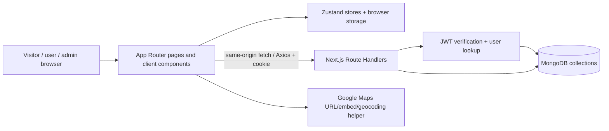

# Architecture

## Stack and structure

- **Framework:** Next.js 16.2.6 App Router (`src/app`), React 19.2.4.
- **Styling/UI:** Tailwind CSS 4, Framer Motion, Lucide React, React Icons; global styles in `src/app/globals.css`.
- **Server:** Next.js Route Handlers (`src/app/api/**/route.js`); no separate backend service found.
- **Database:** MongoDB native driver 7.2 (`src/lib/mongodb.js`); collections are created/used implicitly. No Mongoose, migration system, or schema migration folder found.
- **Client state:** Zustand stores for settings, theme, and filters; auth state is memory-only and initialized from the HttpOnly cookie-backed `/api/auth/me` endpoint. Legacy browser auth state is cleared. Axios uses same-origin cookie credentials.
- **Validation/document shaping:** handwritten helpers in `src/lib/schemas.js`; categories/statuses/amenities are constants.
- **Hosting:** README says Vercel-ready. `.vercel/` exists, but deployment settings/status were not inspected as active configuration. No deployment verification performed.

## Route groups

`(routes)` public site; `(auth)` login/register/admin login; `(contribute)` contribution UI; `(dashboard)` contributor views; `(admin)` admin screens. Root `src/app/layout.js` provides metadata, providers, toast, and visitor tracking. `src/proxy.js` verifies the signed cookie for protected page routing and checks Origin on mutating API requests; handlers still perform authentication and authorization themselves.

## Data-flow diagram

## Authentication and authorization flow

Registration/login handlers hash/check passwords with bcryptjs, sign JWTs, and set an HttpOnly `auth_token` cookie; JSON responses do not return the token. Authenticated APIs verify that cookie, resolve the current user from MongoDB, and compare session version. Admin login additionally checks `ADMIN_ACCESS_TOKEN` and uses a one-hour JWT. Logout clears the cookie; password and privilege changes invalidate prior sessions.

Admin permissions use a module/action allowlist in `hasPermission()`. Superadmin elevation requires the configured `SUPERADMIN_ID`; there is no source-coded identity fallback. API handlers enforce permissions independently of `proxy.js`; integration coverage and runtime verification remain outstanding.

## Database collections observed

`users`, `places`, `reviews`, `reports`, `support_tickets`, `newsletter_subscribers`, `settings` (singleton `_id: site_config`), `visitor_logs`, `audit_logs`, and `favorites`. Fields and indexes are documented in [data contracts](DATA_CONTRACTS.md). The configured Atlas index inventory is verified; MongoDB remains schemaless and representative query plans are not a production-scale benchmark.

## Integrations and external services

- Google Maps: helper builds maps/embed/geocode URL in `src/lib/maps.js`; geocoding depends on an environment API key, external availability/key restrictions are unverified.
- MongoDB: requires `MONGODB_URI`; client singleton connection strategy differs in development vs production.
- Vercel: README mentions target platform; no deployment check.
- Newsletter/contact: email addresses and support messages are stored in MongoDB; newsletter addresses have a permission-gated admin list. There is no automated email delivery integration.
- Visitor tracking: new records include path without query, referrer origin, coarse device/browser/OS labels, and timestamp. New records omit IP, raw user-agent, and screen dimensions. Historical log records may contain fields from the earlier schema and require an operator cleanup/retention decision.
- Images: static local assets plus accepted remote URLs and image data URIs. No upload/storage service or upload API found.

## Architectural concerns

- Build and route behavior for the `src/proxy.js` migration has not passed staging verification.
- API authorization and session invalidation need automated integration coverage; static inspection is not enough to prove the role/action matrix.
- MongoDB schema is implicit and validation differs by endpoint; no migration/versioning layer exists.
- No separate staging database is available; the approved indexes were applied to the configured Atlas database.
- Visitor record retention and historical-field cleanup still require an operator decision.
- Root layout includes client providers and visitor tracking globally; public pages are predominantly client components.

## Evidence

`package.json`; `src/app/layout.js`; `src/app/(routes)/layout.js`; `src/app/(admin)/admin/layout.js`; `src/proxy.js`; `src/lib/{mongodb,auth,permissions,schemas,api}.js`; `src/lib/store/*`; `src/app/api/**/route.js`; `scripts/setup-indexes.mjs`; `README.md`.
